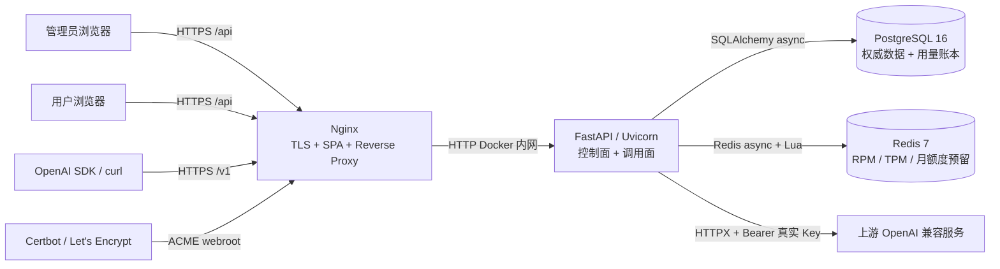
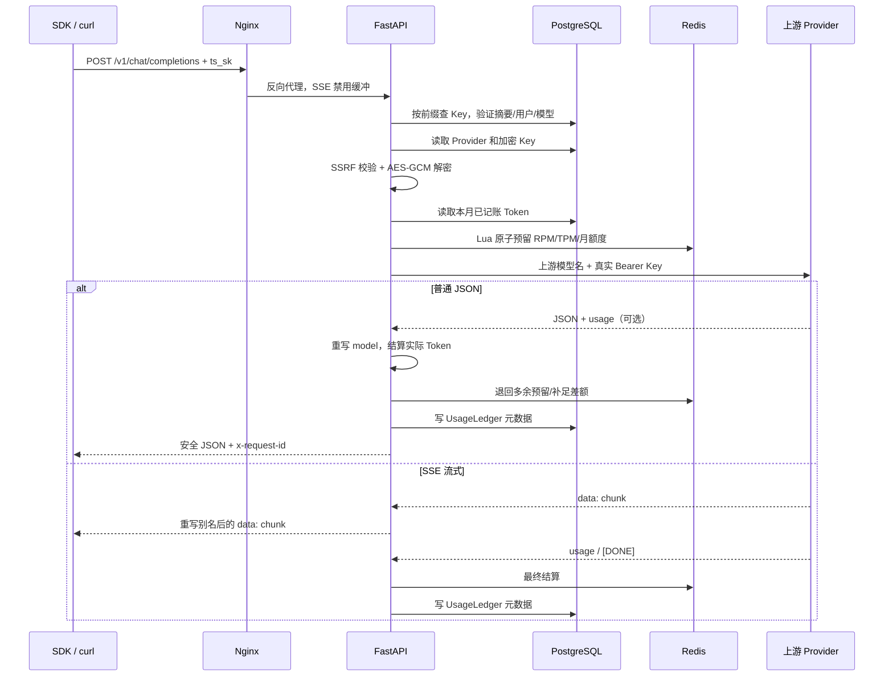
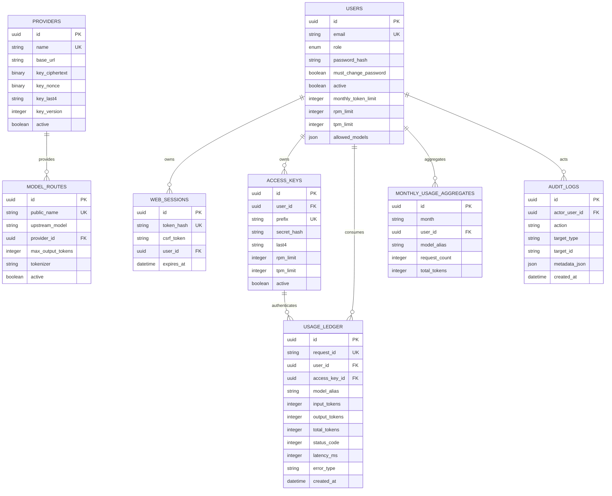

# Token Station 项目架构与技术栈详解

> 文档对象：开发、运维与安全审查人员
> 代码基线：`Token Station v1`
> 生产地址：`https://tokenshare.asia`
> 文档日期：2026-08-18；UI 与统计实现核对更新：2026-11-06（本地代码，不代表生产已部署）

## 1. 项目定位

Token Station 是一个私有的 OpenAI Chat Completions 兼容中转站。它的核心目标不是自己运行大模型，而是在用户与上游模型服务之间提供一个安全的访问、权限、配额和审计层。

系统主要解决四个问题：

1. 管理员可以通过 HTTPS 表单提交真实上游 API Key；保存后管理 API 和页面只能显示末四位并替换，普通用户始终无法读取真实 Key。
2. 每个用户使用独立中转 Key，可被独立撤销和限速。
3. 系统以公开模型别名隔离上游真实模型名和服务商配置。
4. 系统统一执行 RPM、TPM、账号月 Token 额度、用量记账与审计。

该项目是“模型访问网关”，不是聊天记录系统、计费平台或模型调度集群。

## 2. 架构风格

当前采用“模块化单体 + 单机容器编排”架构：

- 一个 FastAPI 进程同时提供控制面 API 和模型调用面 API。
- 一个 React SPA 提供管理员和用户控制台。
- Nginx 是唯一公网入口，同时提供 HTTPS、静态文件和反向代理。
- PostgreSQL 保存权威业务数据和最终用量账本。
- Redis 承担短周期、高并发、需要原子更新的配额预留。
- Docker Compose 在一台阿里云轻量服务器上编排所有服务。

这不是微服务架构。各后端模块在同一个 Python 进程中运行，但以路由、服务、安全、配额和数据模型分层，便于后续拆分。

## 3. 系统全景



公网不会直接访问 FastAPI、PostgreSQL 或 Redis。Docker Compose 只把 Nginx 的 80/443 映射到宿主机。

## 4. 控制面与调用面

项目刻意把两类流量分开。

| 平面 | URL | 调用者 | 身份凭证 | 职责 |
|---|---|---|---|---|
| 控制面 | `/api/*` | 浏览器中的管理员/用户 | 服务端 Session Cookie + CSRF | 登录、用户、上游、模型、Key、用量和日志管理 |
| 调用面 | `/v1/*` | SDK、curl、程序 | `Authorization: Bearer ts_sk_...` | 列出获授权模型、代理 Chat Completions |
| 健康面 | `/health/*` | Nginx、Docker、运维人员 | 无 | 存活与就绪判定 |

这种分离的意义是：浏览器 Session 不能用来调模型，中转 Key 也不能调管理 API。

## 5. 技术栈总览

### 5.1 后端

| 技术 | 当前版本约束 | 作用 | 主要位置 |
|---|---|---|---|
| Python | 包要求 `>=3.9`；生产镜像 3.12 | 后端语言 | `pyproject.toml`、`Dockerfile` |
| FastAPI | `>=0.115,<1` | HTTP API、依赖注入、SSE 响应 | `app/main.py`、`app/api_*.py` |
| Uvicorn | `>=0.32,<1` | ASGI 生产服务器 | `docker-compose.yml` |
| Pydantic v2 | 由 FastAPI 和 `pydantic-settings` 引入 | 请求/响应校验 | `app/schemas.py` |
| pydantic-settings | `>=2.7,<3` | `.env` 与生产密钥校验 | `app/config.py` |
| SQLAlchemy async | `>=2.0,<3` | ORM、异步数据库会话 | `app/database.py`、`app/models.py` |
| Alembic | `>=1.14,<2` | 数据库版本迁移 | `alembic/` |
| asyncpg | `>=0.30,<1` | 生产 PostgreSQL 异步驱动 | `DATABASE_URL` |
| aiosqlite | `>=0.20,<1` | 本地开发和测试 SQLite 驱动 | 开发默认配置 |
| HTTPX | `>=0.28,<1` | 异步调用上游、流式读取 | `app/gateway.py`、`app/services.py` |
| redis-py async | `>=5.2,<7` | Redis 异步客户端和 Lua 执行 | `app/quotas.py` |
| Argon2 | `argon2-cffi>=23.1,<26` | 密码哈希与验证 | `app/security.py` |
| cryptography | `>=44,<49` | AES-256-GCM 上游 Key 加密 | `app/security.py` |
| tiktoken | `>=0.8,<1` | 输入/输出 Token 估算 | `app/services.py` |

### 5.2 前端

| 技术 | 版本 | 作用 |
|---|---:|---|
| React | 19.1.1 | 控制台 UI 和状态管理 |
| React DOM | 19.1.1 | SPA 渲染 |
| TypeScript | 5.9.2 | 类型安全 |
| Vite | 7.x | 本地开发、类型检查和生产构建 |
| lucide-react | 0.468.0 | 界面图标 |
| 原生 CSS | 项目内维护 | 页面布局、响应式和视觉系统 |

前端没有引入 Redux、React Router 或组件库。当前规模下，顶层 `App` 状态和页内 Tab 已能覆盖产品流程。

### 5.3 数据与基础设施

| 技术 | 版本/镜像 | 职责 |
|---|---|---|
| PostgreSQL | 16 Alpine | 用户、Session、上游、模型、Key、用量、审计 |
| Redis | 7 Alpine | RPM/TPM/月额度原子预留、登录 IP 限速 |
| Nginx | 1.27 Alpine | TLS、静态文件、反向代理、SSE、安全响应头 |
| Docker Compose | v2 | 单机服务编排、网络、健康检查和数据卷 |
| Certbot | latest 维护 Profile | Let's Encrypt 证书签发与续期 |
| Shell | POSIX `sh` | 预检、备份、恢复、续期和归档 |

### 5.4 测试与质量

| 技术 | 作用 |
|---|---|
| Pytest | 后端单元/集成测试 |
| pytest-asyncio | 异步数据库和 API 测试 |
| HTTPX MockTransport | 在测试中模拟上游普通和 SSE 响应 |
| Ruff | Python 风格、错误和 import 检查 |
| TypeScript compiler | 前端类型检查 |
| Vite build | 前端生产可构建性验证 |

## 6. 仓库目录与模块边界

```text
token中转站/
├── app/                         FastAPI 后端
│   ├── main.py                   应用组装、中间件、启动、健康检查
│   ├── config.py                 环境配置与生产安全校验
│   ├── database.py               异步 SQLAlchemy Engine/Session
│   ├── models.py                 ORM 数据模型
│   ├── schemas.py                Pydantic API 数据结构
│   ├── deps.py                   Session、CSRF、角色、Bearer Key 依赖
│   ├── security.py               密码、Key、AES-GCM、SSRF 防护
│   ├── quotas.py                 Redis Lua 配额预留与结算
│   ├── services.py               用量、Token 估算、审计、HTTPX
│   ├── api_auth.py               登录、退出、改密
│   ├── api_user.py               用户用量、模型和 Key
│   ├── api_admin.py              管理员业务 API
│   ├── api_proxy.py              旧模块兼容导入
│   ├── gateway.py                Chat / Responses 共用代理、SSE 与结算
│   ├── model_policy.py           接口模式、固定推理和资源隔离策略
│   ├── maintenance.py            90 天日志归档和 13 个月聚合
│   └── cli.py                    运维 CLI 入口
├── frontend/                    React + TypeScript SPA
│   ├── src/App.tsx               Session 恢复和角色分流
│   ├── src/Login.tsx             登录和首次改密
│   ├── src/AdminConsole.tsx      管理员控制台
│   ├── src/UserConsole.tsx       用户控制台和接入示例
│   ├── src/api.ts                fetch 封装与 CSRF 注入
│   ├── src/components.tsx        通用 UI 组件
│   ├── src/types.ts              前端类型合同
│   └── src/styles.css            整体视觉和布局
├── alembic/                     数据库迁移
├── deploy/nginx/                HTTP/HTTPS 模板和入口脚本
├── scripts/                     部署、证书、备份、恢复、归档
├── tests/                       安全与端到端 API 流程测试
├── Dockerfile                   Python API 镜像
├── docker-compose.yml           生产编排
└── frontend/Dockerfile          React 构建 + Nginx 运行镜像
```

## 7. FastAPI 应用启动与生命周期

`app/main.py` 是后端组装根。

启动顺序：

1. `app.config.Settings` 从环境变量和 `.env` 解析配置。
2. 生产模式校验 `SECRET_KEY`、`TOKEN_ENCRYPTION_KEY`、管理员初始密码、Secure Cookie 和 Alembic 模式。
3. Docker Compose 中的 API 命令先执行 `alembic upgrade head`。
4. Uvicorn 加载 `app.main:app`。
5. FastAPI lifespan 检查并创建初始管理员（仅当邮箱不存在）。
6. 创建 `QuotaService`，并连接 Redis。
7. 开始提供路由。
8. 进程关闭时关闭 Redis 客户端。

生产环境关闭 FastAPI `/docs`；开发环境默认开启。

### 7.1 全局中间件

FastAPI 全局处理：

- 基于 `Content-Length` 拒绝超过 2 MiB 的请求。
- 添加 `X-Content-Type-Options`、`X-Frame-Options`、`Referrer-Policy`、CSP 和 Permissions Policy。
- 仅允许配置的 CORS 来源，生产为当前 HTTPS 域名。
- 将 `/v1` 请求参数错误转换为 OpenAI 风格 `error` 结构。

## 8. Web 身份认证与会话

### 8.1 密码

密码使用 Argon2id 哈希，当前参数为：

- `time_cost=3`
- `memory_cost=65536`
- `parallelism=2`

密码长度必须为 12–128 位，并在小写字母、大写字母、数字、符号中至少包含三类。

账号连续失败 5 次后锁定 15 分钟。Redis 和 Nginx 还分别对登录 IP 执行每分钟限速。

### 8.2 服务端 Session

登录成功后：

1. 生成高熅随机 Session Token。
2. 浏览器只在 `HttpOnly + Secure + SameSite=Strict` Cookie 中持有明文 Token。
3. PostgreSQL `web_sessions` 仅保存 Token 的 SHA-256 摘要、CSRF Token、用户和过期时间。
4. 每次请求把 Cookie 再次哈希，与数据库摘要匹配。
5. 用户停用、Session 过期、重置密码或退出后，Session 立即失效。

### 8.3 CSRF

登录响应同时返回 CSRF Token。前端将它保存在 JavaScript 内存中，对 POST、PATCH、DELETE 等写操作添加：

```text
X-CSRF-Token: ...
```

后端使用常量时间比较与 Session 中的值校验。

## 9. 中转 Key 生命周期

中转 Key 格式：

```text
ts_sk_<8位十六进制前缀>_<URL-safe 随机字符>
```

创建流程：

1. 用户提交 Key 名称、RPM 和 TPM。
2. 后端确保 Key 限制不超过账号上限。
3. 每个账号最多保留 5 把有效 Key。
4. 后端生成随机 Key，将前缀、末四位和 SHA-256 摘要写入 PostgreSQL。
5. 明文只在创建响应中返回一次。
6. 前端只在当前 Modal 状态显示它，不写入 localStorage。
7. 关闭弹窗后，系统无法恢复明文；丢失后只能撤销并重建。

验证时先从 Key 中取出前缀，用索引查找候选记录，再对完整明文计算 SHA-256 并使用常量时间比较。撤销或用户停用会立即使后续调用失效。

## 10. 上游 Key 加密与 SSRF 防护

### 10.1 AES-256-GCM

真实上游 Key 使用 AES-256-GCM 加密：

- 主密钥由 `TOKEN_ENCRYPTION_KEY` 注入，URL-safe Base64 解码后必须正好 32 字节。
- 每次加密使用独立的 12 字节随机 nonce。
- AAD 包含 `token-station:v<key_version>`，使密文与密钥版本绑定。
- PostgreSQL 保存密文、nonce、末四位和版本，不保存主密钥。
- 控制台只返回末四位；管理员可替换 Key，不能读取旧明文。

`TOKEN_ENCRYPTION_KEY` 一旦丢失或被随意替换，已保存上游 Key 将无法解密。

### 10.2 Base URL 防护

上游 URL 在保存、连接测试和每次代理调用前都会校验：

- 只允许 `https://`。
- 必须有有效域名。
- 不允许 URL 内嵌用户名或密码。
- 不允许 query 和 fragment。
- 解析域名的所有地址，默认只接受公网 IP。
- 拒绝回环、私网、链路本地和其他非全球地址。
- HTTPX 关闭自动重定向，避免经过 30x 跳到内网。

## 11. Provider 与 ModelRoute

`Provider` 表示一个上游 OpenAI 兼容服务，保存：

- 名称和 HTTPS Base URL。
- 加密 API Key。
- 超时时间。
- 是否支持流式 usage。
- 是否启用。

`ModelRoute` 表示一条公开模型路由，保存：

- `public_name`：用户和 SDK 看到的模型名。
- `upstream_model`：发给上游的真实模型名。
- `provider_id`：所属上游。
- `max_output_tokens`：单次最大输出上限和默认预留上限。
- `tokenizer`：无 usage 时用于估算。
- `active`：是否启用。

用户表的 `allowed_models` 是公开模型名数组。调用时必须同时满足：

1. 公开模型名在用户允许列表中。
2. ModelRoute 已启用。
3. Provider 已启用。

## 12. Chat Completions 代理链路



### 12.1 入站请求

`ChatRequest` 明确校验：

- `model`
- `messages`
- `stream`
- `max_tokens`
- `max_completion_tokens`
- `stream_options`

Pydantic 配置为 `extra="allow"`，因此 tools、tool_choice、response_format、temperature、图片内容等其他 OpenAI 兼容字段可随请求一起转发。

系统会把 `model` 从公开别名替换为上游真实模型名。对支持流式 usage 的 Provider，还会自动设置：

```json
{
  "stream_options": {
    "include_usage": true
  }
}
```

### 12.2 上游请求头

后端不复制用户的完整请求头，而是重新构造最小头集：

- `Authorization: Bearer <解密后的上游 Key>`
- `Content-Type: application/json`
- `Accept: application/json` 或 `text/event-stream`
- `X-Client-Request-Id`

Cookie、用户的 Authorization、X-Forwarded-* 和其他入站头不会转发给上游。HTTPX 会根据真实上游 URL 生成 Host。

### 12.3 普通响应

普通响应流程：

1. 上游超时转为 504。
2. 连接错误转为 502。
3. 上游 400/401/403/404/429 保留状态码，其他上游错误统一为 502。
4. 不把上游原始错误正文返回用户。
5. 成功响应顶层 `model` 重写为公开别名。
6. 优先使用上游 usage；缺失时估算 Token。
7. 记录用量元数据并返回 `x-request-id`。

聊天请求不会自动重试，避免重复生成和重复计费。

### 12.4 SSE 流式响应

流式路径使用 HTTPX `stream=True` 和 FastAPI `StreamingResponse`：

- 只处理 `data:` 行。
- 每个 JSON 事件都把 `model` 重写为公开别名。
- 上游 error 事件会被替换为安全错误。
- 无法解析的 SSE 会返回安全错误并结束。
- 客户端断开会触发 CancelledError，关闭上游响应和 HTTPX Client。
- Nginx 对 `/v1/` 关闭 proxy buffering 和 cache，并把读写超时提高到 600 秒。

为在缺少 usage 时估算输出 Token，当前进程会在内存中暂存已解析的 delta 片段。这些内容不会写入 PostgreSQL 或应用日志。

## 13. 配额预留与结算

配额系统使用“请求前预留，请求后结算”模型。

### 13.1 预留量

请求前：

1. 用配置 tokenizer 估算 `messages` 的输入 Token。
2. 如果客户端指定 `max_tokens` 或 `max_completion_tokens`，检查它不超过路由上限。
3. 未指定时使用 `ModelRoute.max_output_tokens` 作为保守输出预留。
4. 预留量 = 估算输入 + 最大输出。

### 13.2 限制维度

Redis Lua 脚本在一次原子操作中检查：

- 每把 Key 当前分钟 RPM。
- 每把 Key 当前分钟 TPM。
- 当前账号上海时区自然月 Token 总额度。

每把 Key 的实际 RPM/TPM 上限取 Key 配置与账号配置的较小值。月额度按账号共享，用户不能通过创建多把 Key 绕过。

### 13.3 最终结算

请求完成后：

- 有 usage 时用真实 prompt/completion Token。
- 无 usage 时用 tiktoken 估算；tokenizer 不可用时退化为约每 4 字符 1 Token。
- Redis Lua 使用“实际值 - 预留值”调整 TPM 和月额度。
- RPM 不退回，因为请求确实已经发生。
- PostgreSQL 写入最终用量账本。

本地开发没有 Redis 时，`QuotaService` 提供进程内字典和 asyncio Lock 的降级实现；它只适合开发与测试，不适合多进程生产。

## 14. 数据模型



### 14.1 表职责

| 表 | 职责 | 敏感度 |
|---|---|---|
| `users` | 账号、角色、密码哈希、额度、模型权限 | 高 |
| `web_sessions` | Session 摘要和 CSRF | 高 |
| `providers` | 上游配置和加密 Key | 极高 |
| `model_routes` | 公开别名到上游模型映射 | 中 |
| `access_keys` | 中转 Key 摘要、指纹和限制 | 高 |
| `usage_ledger` | 单请求 Token、状态、耗时和错误类型 | 中 |
| `monthly_usage_aggregates` | 已归档的按月/用户/模型聚合 | 中 |
| `audit_logs` | 管理和 Key 操作记录 | 高 |

PostgreSQL 使用 JSONB 保存数组/元数据；SQLite 开发环境使用通用 JSON 变体。所有业务时间写入 UTC，月份和日趋势在计算时转换为 `Asia/Shanghai`。

## 15. API 路由地图

### 15.1 认证

| 方法 | 路径 | 用途 |
|---|---|---|
| POST | `/api/auth/login` | 登录并创建 Session |
| GET | `/api/auth/session` | 恢复当前 Session |
| POST | `/api/auth/logout` | 删除当前 Session |
| POST | `/api/auth/change-password` | 首次/主动修改密码 |

### 15.2 用户控制台

| 方法 | 路径 | 用途 |
|---|---|---|
| GET | `/api/me` | 账号信息 |
| GET | `/api/me/usage` | 本月 Token 和每日趋势 |
| GET | `/api/me/analytics?period=month\|7d\|30d` | 当前用户的期间汇总、每日趋势、模型消耗排行 |
| GET | `/api/me/models` | 已授权公开模型 |
| GET | `/api/me/keys` | 列出自己的 Key 指纹 |
| POST | `/api/me/keys` | 创建 Key，明文只返回一次 |
| DELETE | `/api/me/keys/{key_id}` | 撤销自己的 Key |

### 15.3 管理员

| 方法 | 路径 | 用途 |
|---|---|---|
| GET | `/api/admin/dashboard` | 30 天请求、Token、成功率、延迟 |
| GET | `/api/admin/analytics?period=month\|7d\|30d` | 全站期间汇总、每日趋势、模型及用户消耗排行 |
| GET/POST/PATCH | `/api/admin/users...` | 用户创建、更新、停用 |
| POST | `/api/admin/users/{id}/reset-password` | 重置临时密码 |
| GET/POST/PATCH | `/api/admin/providers...` | 上游创建、更新、换 Key |
| POST | `/api/admin/providers/{id}/test` | 用解密 Key 调上游 `/models` |
| GET/POST/PATCH | `/api/admin/models...` | 模型映射管理 |
| GET | `/api/admin/logs` | 请求元数据日志 |
| GET | `/api/admin/audit` | 审计日志 API |

### 15.4 OpenAI 兼容

| 方法 | 路径 | 用途 |
|---|---|---|
| GET | `/v1/models` | 列出当前 Key 用户可用别名 |
| POST | `/v1/chat/completions` | 非流式 JSON 或 SSE Chat Completions |
| POST | `/v1/responses` | 无状态 JSON / SSE Responses，客户端工具循环 |

### 15.5 健康检查

| 方法 | 路径 | 判定 |
|---|---|---|
| GET | `/health/live` | FastAPI 进程能响应 |
| GET | `/health/ready` | PostgreSQL、Redis、Alembic 版本全部正常 |

### 15.6 用量统计口径

`app/analytics.py` 为两个 analytics 接口提供共享查询。`period` 默认 `month`，也可选 `7d` 或 `30d`；非法值返回 422。起点为北京时间本月首日或含今天的最近 7/30 个自然日零点，终点为查询开始时间，筛选范围为 `[start, end)`，不会把未来时间的记录纳入统计。

响应包含 `period`、UTC ISO 格式的 `start`/`end`、`timezone: "Asia/Shanghai"`、`summary`、`daily` 与 `models`；管理员响应额外包含 `users`。用户接口依据当前 Session 的用户 ID 限定查询，不接受代查其他用户的参数，管理员接口要求管理员角色；两者都要求完成首次改密。

- 统计覆盖所选范围内完整的 `usage_ledger`，不受日志列表 200 条上限影响，也不读取提示词和回答。
- SQL 按北京时间日期聚合输入、输出、总 Token、请求数、成功数和耗时总和，应用补齐无请求的日期；PostgreSQL 使用 `timezone` 后转日期，SQLite 使用 UTC 加八小时。
- 状态码小于 400 记为成功，其他已入账记录记为失败。平均耗时为全部已入账请求的完整耗时，包括流式持续时间；它不是首 Token 延迟。无请求时成功率和平均耗时返回 `null`，前端显示 `—`。
- 模型及用户排行按总 Token 降序取前五项，剩余项汇总为“其他”；相同 Token 使用 ID 排序。排名只反映已入账调用，不表示上游可用率或网关全部鉴权失败次数。
- 数值在 API 和数据库中仍是整数 Token；前端统一显示 M（1 M = 1,000,000 Token）。配额、TPM、最大输出的输入框保留整数 Token 并提供 M 换算提示。
- `/api/me/usage` 继续独立提供本月额度数据；切换趋势期间不会改变本月额度含义。新增统计复用现有表，无数据库迁移。

## 16. React 前端架构

### 16.1 启动和身份分流

`App.tsx` 启动后请求 `/api/auth/session`：

```text
无 Session            → Login（访客控制台 + 登录弹窗）
有 Session + 待改密   → PasswordGate
角色 admin          → AdminConsole
角色 user           → UserConsole
```

项目没有客户端路由库；界面切换是 React 状态和 Tab 状态。Nginx 对静态路径使用 SPA fallback，返回 `index.html`。

访客复用 `UserConsole`，可切换用量、访问 Key 和接入指南；身份相关数值显示 `—`，不请求私有用量、模型和 Key 数据。登录入口打开 Modal，成功后由 `App` 按首次改密状态和角色分流。当前视觉采用暖色农场菜单：像素背景、居中羊皮纸主窗口、木框和顶部 Tab，移除原固定侧栏。布局以桌面网页为主，窄窗口通过换行和横向 Tab 保持可用，具体设计见 `DESIGN.md`。

### 16.2 API 封装

`frontend/src/api.ts` 统一：

- `credentials: "include"` 发送 HttpOnly Cookie。
- 对非 GET/HEAD/OPTIONS 请求自动添加 `X-CSRF-Token`。
- JSON 请求自动添加 Content-Type。
- 把后端安全错误转换为前端 Error。
- 提供中文数字和日期格式化。

Token 展示由 `formatTokens.ts` 统一处理为 M 单位，最多三位小数，非零小值显示 `<0.001 M`；可通过详情查看精确整数。`Analytics.tsx` 共用期间选择、SVG 图表和排行，支持鼠标悬停与键盘聚焦；通过取消请求与活动状态检查避免过期响应覆盖新期间，失败时保留并标明上次成功数据。

CSRF Token 只在当前页面的 JavaScript 内存中。刷新后通过 Session API 重新获取。

### 16.3 管理员控制台

当前页签：

- 总览：本月/近 7 天/近 30 天 Token、请求数、成功率、平均完整请求耗时；每日输入/输出和成功/失败图表，模型及用户排行，以及上游状态和近期调用。
- 上游：新增、编辑、换 Key、连接测试、启停。
- 模型：公开别名、真实模型、Provider、输出上限和 Tokenizer。
- 用户：创建、配额、模型授权、重置密码、启停。
- 调用日志：请求 ID、用户、模型、Token、延迟和状态。

- 审计日志：已接入 `/api/admin/audit`，展示操作人、动作、目标和元数据。

### 16.4 用户控制台

当前页签：

- 用量：固定本月已用/剩余额度，另有可切换期间的输入/输出趋势、请求指标、模型占比，以及已授权模型。
- 访问 Key：创建、显示一次明文、指纹列表、撤销。
- 接入指南：分为聊天 API、编码 API、CC Switch + Codex 三条路径，按准备 Key、选授权模型、配置、验证、排错组织内容；地址来自当前域名，配置与示例由 `guideSnippets.ts` 生成。无授权模型时显示前置条件，不生成假配置。CC Switch 教程分别说明 CLI、桌面端、凭证与配置目录差异，兼容性以实际客户端验证为准。

### 16.5 弹窗焦点

公共 `Modal` 将关闭回调通过 ref 保持最新，初始化焦点的 Effect 只在挂载时运行，避免父组件每次输入生成新回调后把焦点抢回第一个输入框。Tab/Shift+Tab 限定在可见可聚焦控件中，Escape 使用最新回调关闭；关闭后仅在原触发元素仍存在时恢复焦点。这同时覆盖登录与管理表单。

## 17. Docker 与 Nginx 生产架构

### 17.1 Compose 服务

| 服务 | 网络 | 公网端口 | 数据持久化 |
|---|---|---|---|
| `postgres` | `internal` | 无 | `postgres_data` |
| `redis` | `internal` | 无 | `redis_data` |
| `api` | `internal` | 无，仅容器 8000 | 业务状态在 PostgreSQL/Redis |
| `nginx` | `internal` + 宿主机 | 80/443 | 挂载证书和 ACME webroot |
| `certbot` | maintenance profile | 无 | 与 Nginx 共享证书卷 |

`postgres`、`redis` 健康后 API 才启动；API `/health/ready` 通过后 Nginx 才启动。

### 17.2 API 镜像

API 镜像基于 `python:3.12-slim`：

- 安装项目依赖。
- 复制 `app/` 和 `alembic/`。
- 创建并使用非 root 用户 `tokenstation`。
- 容器内监听 8000。

### 17.3 前端/Nginx 镜像

`frontend/Dockerfile` 是多阶段构建：

1. Node 22 Alpine 执行 `npm ci` 和 `npm run build`。
2. 只把 `dist/` 复制到 Nginx 1.27 Alpine。
3. 安装 `gettext`，使用 `envsubst` 注入域名。
4. 入口脚本根据 `TLS_ENABLED` 选择 HTTP 或 HTTPS 模板。

HTTPS 模板：

- 80 端口保留 ACME，其他请求 301 到 HTTPS。
- 443 开启 TLS 1.2/1.3 和 HTTP/2。
- `/api/`、`/v1/`、`/health/` 分别代理。
- `/assets/` 使用一年 immutable 缓存。
- SPA 入口使用 `no-store`。
- 登录路由增加 Nginx IP 限速。
- SSE 关闭缓冲、缓存和 Connection 头。

## 18. 数据生命周期与运维

### 18.1 请求日志

`usage_ledger` 仅保存：

- 请求 ID
- 用户 ID
- Key ID
- 公开模型别名
- 输入/输出/总 Token
- 状态码
- 延迟
- 安全错误类型
- UTC 时间

不保存 messages、回答正文、Authorization 或完整请求头。

### 18.2 归档

`scripts/retention.sh` 在 API 容器中运行 `app.cli retention`：

1. 查找超过 `LOG_RETENTION_DAYS`（默认 90 天）的请求元数据。
2. 按上海时区月份、用户和模型汇总。
3. 写入 `monthly_usage_aggregates`。
4. 删除已汇总的请求级元数据。
5. 只保留最近 13 个月聚合。

### 18.3 备份与恢复

- `backup.sh` 使用 `pg_dump` 输出 gzip SQL，权限 600，本机保留 7 天。
- `restore.sh` 需要 `CONFIRM_RESTORE=yes`，停止 API/Nginx，重建数据库并导入。
- `renew-tls.sh` 运行 Certbot renew 后 reload Nginx。
- `preflight.sh` 检查 Docker、Compose、CPU、内存、磁盘和端口。

数据库备份和阿里云系统盘快照解决的问题不同：前者适合业务数据恢复，后者适合整机误操作或攻击后回滚。

## 19. 测试架构

### 19.1 安全单元测试

`tests/test_security.py` 覆盖：

- AES-GCM 加解密往返。
- 密文不包含明文 Key。
- 中转 Key 格式、指纹和摘要。
- 密码强度。
- 拒绝解析到私网的上游 URL。

### 19.2 API 集成测试

`tests/test_app.py` 使用 HTTPX MockTransport 模拟上游，覆盖：

- 初始管理员登录与首次改密。
- 带 CSRF 的上游、模型和用户创建。
- 上游连接测试。
- 用户创建 Key，明文不再出现于列表。
- `/v1/models` 权限过滤。
- 普通 Chat Completions 模型名重写。
- SSE 模型名重写和 `[DONE]`。
- 用量入账。
- Provider 密文不含明文。
- 90 天日志归档为月度聚合。

### 19.3 当前测试边界

当前自动测试尚未完整覆盖：

- 真实上游服务商的兼容差异。
- 30 路以上真实 SSE 并发。
- 浏览器端 E2E 自动化。
- 上游流式中途断开的所有 TCP 边界。
- 备份到异地存储和整机灾备演练。

这些应在生产规模扩大前补充。

## 20. 已实现能力与明确边界

### 20.1 已实现

- 管理员/用户两角色。
- 管理员创建用户，首次登录强制改密。
- 上游 Key 加密、只能替换不能读取。
- 公开模型别名和用户模型授权。
- 用户自助创建/撤销最多 5 把 Key。
- RPM、TPM 和账号月额度。
- `/v1/models`、`/v1/chat/completions` 和无状态 `/v1/responses`。
- 普通 JSON 和 SSE。
- 安全错误转换、请求 ID 和元数据日志。
- 中文控制台、Docker Compose、HTTPS、备份和归档。

### 20.2 不在 v1 范围

- 公开注册、邮件找回密码、TOTP。
- 支付、充值、余额、按金额计费。
- Embeddings、Images、Audio、Realtime。后续双模式版本已增加无状态 Responses，详见 [聊天与编码模式接入指南](聊天与编码模式接入指南.md)。
- 单个公开模型的多上游故障转移。
- 会话正文、提示词或回答持久化。
- 自动重试聊天请求。
- Kubernetes、多节点高可用和跨地域容灾。

## 21. 当前实现注意事项

### 21.1 主密钥版本

数据库保存 `key_version`，但当前解密只接受与现行 `TOKEN_ENCRYPTION_KEY_VERSION` 完全一致的版本。尚未实现多版本密钥环和在线重加密。轮换主密钥前必须先实现迁移流程。

### 21.2 `SECRET_KEY`

生产启动会强制 `SECRET_KEY` 为非默认强随机值，但当前 Web Session 是“随机不透明 Token + 服务端 SHA-256 摘要”模型，不使用它签名 Cookie。该配置目前是为后续服务端签名需求保留的安全配置。

### 21.3 审计不可篡改边界

应用只提供审计日志的创建和读取路径，不提供修改/删除 API。但 PostgreSQL 超级用户或服务器 root 理论上仍可改数据；当前不是密码学防篡改日志。

### 21.4 首次 TLS 脚本

`enable-tls.sh` 负责先以 HTTP 模式启动、签发证书、把 `.env` 改为 `TLS_ENABLED=true` 并重建 Nginx。当前部署过程曾触发已导出的 `TLS_ENABLED=false` 覆盖新 `.env` 值的问题，生产已使用显式 `TLS_ENABLED=true` 重建 Nginx 恢复。该脚本应在下一次代码发布中修复。

### 21.5 当前单机容量模型

当前生产是单 API 容器、单 PostgreSQL、单 Redis 和单 Nginx。Redis 和 PostgreSQL 使得核心状态可以在多 API 实例间共享，但扩容前仍需要补充连接池、负载均衡、迁移串行化、观测性和容灾设计。

## 22. 后续演进建议

从当前架构出发，推荐按以下顺序演进：

1. 修复首次 TLS 脚本的环境变量优先级问题，补脚本测试。
2. 为备份脚本增加 pipefail/完整性检查，并自动复制到独立 OSS。
3. 增加 Playwright 浏览器 E2E 和真实流式并发验收。
4. 在已有管理员审计日志页签上补充分页与查询能力。
5. 增加可观测性：结构化日志、Prometheus 指标和告警。
6. 实现主密钥多版本轮换与重加密工具。
7. 无状态 Responses 已增加；Embeddings、多上游故障转移和有状态 Responses 仍不在当前范围。

## 23. 开发者阅读路径

新开发者可按以下顺序阅读代码：

1. `README.md`：先了解产品边界。
2. `docker-compose.yml`：理解生产服务拓扑。
3. `app/config.py` 和 `app/main.py`：理解启动与安全基线。
4. `app/models.py`：理解业务数据。
5. `app/deps.py` 和 `app/security.py`：理解身份和密钥边界。
6. `app/gateway.py`、`app/model_policy.py` 和 `app/quotas.py`：理解双模式中转链路。
7. `app/api_auth.py`、`app/api_user.py`、`app/api_admin.py`：理解控制面。
8. `frontend/src/App.tsx`：理解前端角色分流。
9. `frontend/src/AdminConsole.tsx` 和 `UserConsole.tsx`：理解页面业务。
10. `tests/`：通过可执行用例理解安全不变量。

## 24. 相关文档

- [阿里云轻量服务器部署指南](阿里云轻量服务器部署指南.md)
- [日常迭代与线上发布指南](日常迭代与线上发布指南.md)
